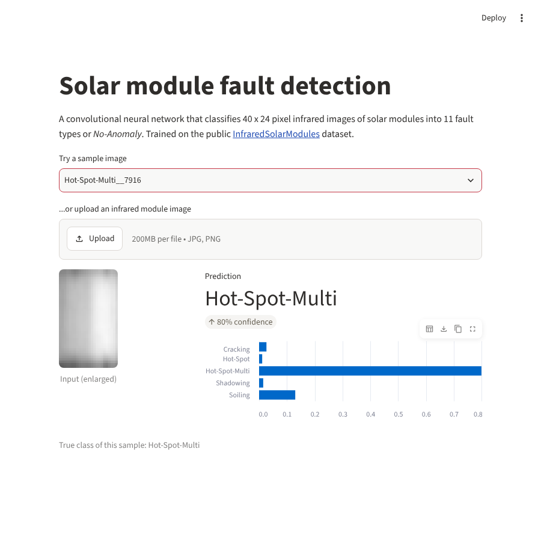
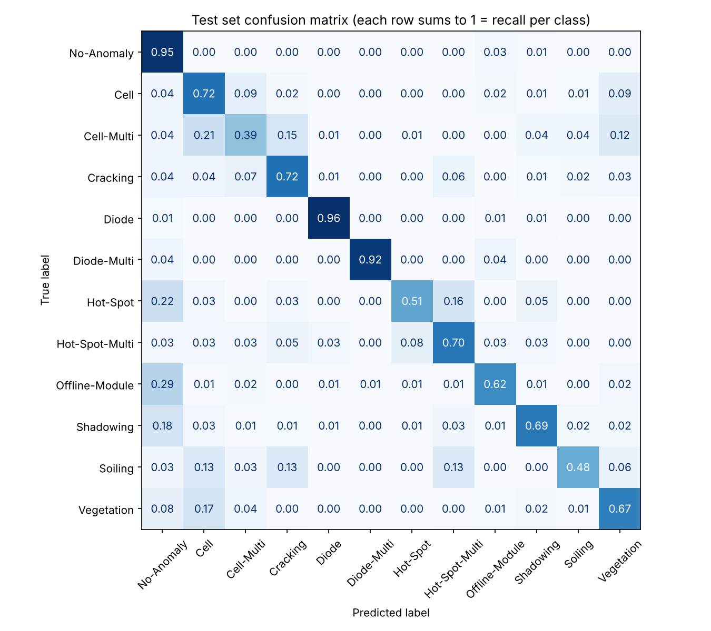
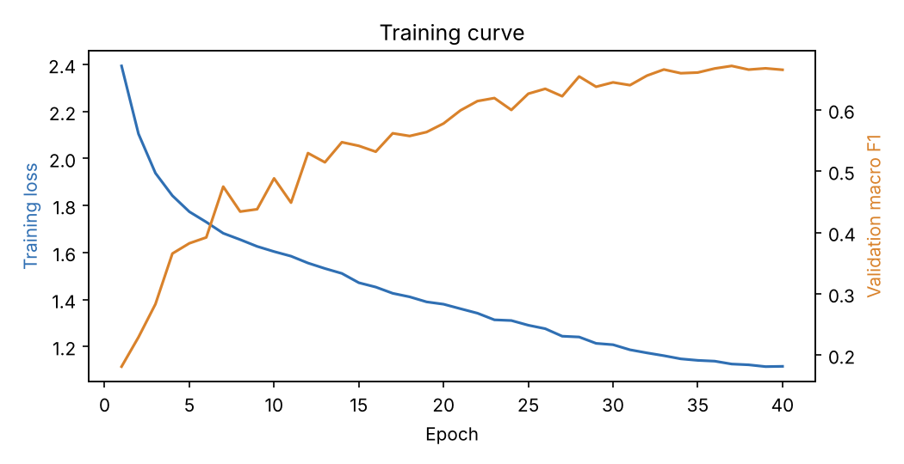

# Solar Module Fault Detection with a CNN

[](https://github.com/Siya166/solar-fault-detection-cnn/actions/workflows/ci.yml)

A convolutional neural network that looks at an infrared (thermal) image of a solar module and says whether it is faulty and, if so, what kind of fault it has: 11 fault types such as cracking, hot spots, bypass-diode failures, soiling and vegetation, or no anomaly.

**Why it matters:** solar farms are inspected by drones carrying thermal cameras, producing thousands of module images per site. Sorting them by hand is slow. A model that flags the faulty modules, and the likely cause, tells a maintenance crew where to go and what to bring.



## Results

Evaluated once on a held-out test set of 3,000 images that the model never saw during training or model selection.

| Question | Metric | Result | 95% bootstrap CI |
| --- | --- | --- | --- |
| Is this module faulty at all? | Anomalies found (recall) | **91.8%** | |
| | Flagged modules that really are faulty (precision) | **94.5%** | |
| | Accuracy | 93.2% | |
| Which of the 12 classes is it? | Accuracy | **81.6%** | 80.2% to 83.1% |
| | Macro F1 (every class counts equally) | 0.69 | 0.66 to 0.72 |

For comparison, always guessing "No-Anomaly" would score 50% accuracy and find no faults.



**Where it does well:** bypass-diode faults (F1 0.95 single, 0.92 multiple) have a clear thermal signature, about a third of the module heated, and are almost always caught.

**Where it struggles, and why:** *Cell-Multi* is often predicted as *Cell* (one hot cell vs several look alike at 40 x 24 pixels), and *Soiling* (31 test images) and *Hot-Spot* classes have few examples. Per-class results are in [`results/classification_report.txt`](results/classification_report.txt).



## Data

[InfraredSolarModules](https://github.com/RaptorMaps/InfraredSolarModules) by Raptor Maps (MIT licence): 20,000 greyscale infrared images, 40 x 24 pixels, from real solar farms. Half are *No-Anomaly*; the rarest fault class has 175 images. Published at the ICLR 2020 AI for Earth Sciences workshop.

## Method

- **Split:** stratified 70% train / 15% validation / 15% test with a fixed seed, so every class has the same share in each part and results are reproducible.
- **Model:** three convolutional blocks (two 3x3 convolutions with batch normalisation, then 2x2 max pooling and dropout), followed by a small fully connected classifier. 782,000 parameters, 3 MB on disk.
- **Why not a pretrained ResNet?** ImageNet models expect 224 x 224 colour photos. These are 40 x 24 single-channel thermal images; a small network trained from scratch suits them better and trains on a laptop CPU in about 12 minutes.
- **Per-image standardisation:** each image is centred and scaled on its own mean and standard deviation, because absolute temperatures vary between flights while faults show up as relative hot areas.
- **Class imbalance:** cross-entropy weighted by inverse square-root class frequency, so rare faults are not ignored, without overcorrecting.
- **Augmentation:** random horizontal and vertical flips (a fault mirrored is still the same fault).
- **Training:** AdamW with a one-cycle learning-rate schedule, 40 epochs, label smoothing 0.05. The checkpoint with the best **validation** macro F1 is kept, and the test set is used once at the end.
- **Uncertainty:** 1,000-sample bootstrap confidence intervals on the test metrics.

## Run it

Python 3.10 or newer.

```bash
git clone https://github.com/Siya166/solar-fault-detection-cnn.git
cd solar-fault-detection-cnn
pip install -e ".[dev,app]"

streamlit run app.py               # demo with the trained model in models/ (no download needed)
pytest                              # 12 tests

python -m solarfault.download       # fetch the dataset (15 MB) to retrain
python -m solarfault.train          # about 12 minutes on a 4-core CPU
python -m solarfault.evaluate       # test report and figures in results/
```

## Project structure

```
app.py                  Streamlit demo
samples/                one test image per class for the demo
models/solar_fault_cnn.pt  trained weights
src/solarfault/
  download.py           downloads and unzips the dataset
  data.py               metadata, stratified split, standardisation, augmentation
  model.py              the CNN
  train.py              training loop with validation-based checkpointing
  evaluate.py           test metrics, bootstrap CIs, confusion matrix
  predict.py            classify a single image
tests/                  pytest tests for data handling and the model
results/                metrics and figures from the run above
```

## What I would try next

- Combine *Cell* and *Cell-Multi*, or add a second-stage classifier for them.
- Test-time augmentation (average predictions over flipped copies).
- Calibrate the confidence scores so "80% confident" means right 80% of the time.
- Deploy the demo on Streamlit Community Cloud.

## Licence

Code: MIT. Dataset: MIT, © Raptor Maps.
